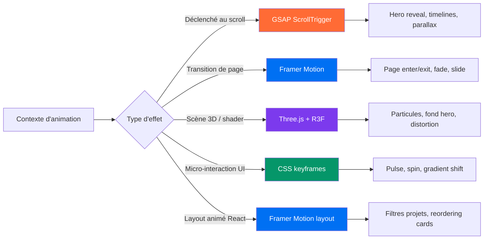
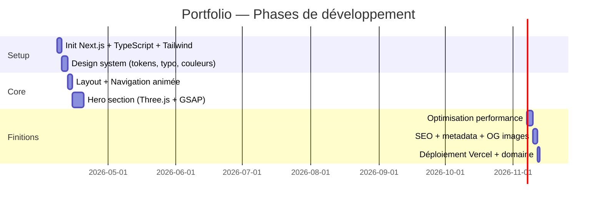
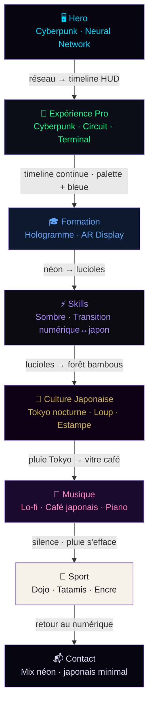

<!--
  © 2026 Louis Guillory (Silence Wolf) — Tous droits réservés
  Licence : PROPRIETARY — voir fichier LICENSE
-->

# Portfolio — Feuille de route

> Portfolio personnel axé visibilité & personal branding, avec animations immersives et effets visuels avancés.

---

## 0. Licence & Propriété

| Propriété | Valeur |
|---|---|
| **Auteur** | Louis Guillory (Silence Wolf) |
| **Licence** | PROPRIETARY — usage personnel exclusif |
| **Données** | Données personnelles réelles (CV, coordonnées) — distribution interdite |
| **Fichier LICENSE** | `outils/licenses/PROPRIETARY.txt` à copier à la racine du projet |

**Justification du choix PROPRIETARY :**
Le portfolio contient des données personnelles réelles (coordonnées, parcours, CV). Même si le site est public en lecture, le code source, les assets et les données restent la propriété exclusive de Louis Guillory. Aucun tiers ne peut reproduire, distribuer ou réutiliser l'ensemble sans accord écrit.

**Bloc de signature — à insérer en tête de chaque fichier source :**

```ts
// ============================================================
// © 2026 Louis Guillory (Silence Wolf) — Tous droits réservés
// Licence : PROPRIETARY — voir fichier LICENSE
// ============================================================
```

---

## 1. Vue d'ensemble

| Propriété | Valeur |
|---|---|
| **Type** | Portfolio mixte (dev + créatif) |
| **Objectif** | Visibilité personnelle, personal branding |
| **Ambiance** | Immersif · Dark mode · Typographie forte · Effets GPU |
| **Public cible** | Communauté dev/design, recruteurs, curieux |

### Identité visuelle (à définir)
- [ ] Nom / tagline
- [ ] Palette de couleurs (ex : dark bg + accent néon / gradient)
- [ ] Typographie principale (ex : Clash Display, Syne, Space Grotesk)
- [ ] Typographie code (ex : JetBrains Mono)

---

## 2. Stack technique

| Couche | Outil | Rôle |
|---|---|---|
| Framework | **Next.js 14** (App Router) | SSR, routing, performances |
| Animations scroll | **GSAP + ScrollTrigger** | Séquences d'animation au scroll |
| Transitions React | **Framer Motion** | Transitions de pages, micro-interactions |
| 3D / WebGL | **Three.js + React Three Fiber** | Scènes 3D, shaders, particules |
| Styling | **Tailwind CSS + CSS variables** | Design tokens, effets CSS avancés |
| Déploiement | **Vercel** | CI/CD, edge network |
| Typage | **TypeScript** | Robustesse du code |

---

## 3. Architecture du site

```mermaid
flowchart TD
    A[Landing Page /] --> B[Hero Section]
    A --> C[Projects Section]
    A --> D[About Section]
    A --> E[Contact Section]

    B --> B1[Scène Three.js / particules]
    B --> B2[Texte animé GSAP]

    C --> C1[/projects/:slug]
    C1 --> C2[Case study détaillé]

    D --> D1[Timeline animée]
    D --> D2[Skills interactifs]

    E --> E1[Formulaire contact]
    E --> E2[Liens réseaux]

    style B fill:#1a1a2e,color:#e0e0ff
    style B1 fill:#16213e,color:#a0cfff
    style C1 fill:#0f3460,color:#fff
```

---

## 4. Sections — Détail & effets visuels

### 4.1 Hero
**Objectif :** Créer un impact immédiat, ancrer l'identité visuelle.

| Élément | Effet prévu | Outil |
|---|---|---|
| Fond | Scène 3D — particules ou shader de bruit | Three.js / R3F |
| Titre | Révélation lettre par lettre ou split-text | GSAP |
| Sous-titre | Fade-in décalé | Framer Motion |
| Scroll indicator | Animation loop CSS | CSS keyframes |

```
┌─────────────────────────────────────┐
│  [  fond 3D animé — particules  ]   │
│                                     │
│       Prénom NOM                    │
│       Developer & Creative          │
│                                     │
│       [ CTA ]  [ scroll ↓ ]         │
└─────────────────────────────────────┘
```

---

### 4.2 Projets
**Objectif :** Présenter les réalisations avec une navigation engageante.

| Élément | Effet prévu | Outil |
|---|---|---|
| Cards | Hover 3D (perspective transform) | CSS + Framer Motion |
| Apparition | Stagger au scroll | GSAP ScrollTrigger |
| Filtres | Transition animée des catégories | Framer Motion layout |
| Lien vers case study | Page dédiée avec transition fluide | Next.js + Framer |

```
┌──────────┐  ┌──────────┐  ┌──────────┐
│ Projet A │  │ Projet B │  │ Projet C │
│  [img]   │  │  [img]   │  │  [img]   │
│  titre   │  │  titre   │  │  titre   │
│  tags    │  │  tags    │  │  tags    │
└──────────┘  └──────────┘  └──────────┘
```

---

### 4.3 À propos
**Objectif :** Humaniser le profil, raconter un parcours.

| Élément | Effet prévu | Outil |
|---|---|---|
| Timeline parcours | Dessin progressif au scroll | GSAP ScrollTrigger |
| Skills | Barres / icônes animées | Framer Motion |
| Photo / avatar | Distortion WebGL au hover | Three.js shader |
| Texte | Parallax subtil | GSAP |

---

### 4.4 Contact
**Objectif :** Faciliter la prise de contact avec une UX soignée.

| Élément | Effet prévu | Outil |
|---|---|---|
| Formulaire | Focus animations, validation live | Framer Motion |
| Bouton submit | Morphing état / loader | CSS + Framer |
| Liens sociaux | Hover magnétique | GSAP |
| Background | Gradient animé CSS | CSS |

---

## 5. Stratégie d'animation



### Règles de performance
- Préférer `transform` et `opacity` pour les animations (pas de reflow)
- Three.js chargé en lazy (dynamic import Next.js)
- `will-change` uniquement sur les éléments activement animés
- Respecter `prefers-reduced-motion`

---

## 6. Roadmap de développement



---

## 7. Attentes détaillées par section — Contenu & Ambiance visuelle

> Cette section détaille les données réelles issues du CV de Louis Guillory, les ambiances visuelles cibles pour chaque bloc, et les transitions entre elles.

---

### 7.1 Hero — Identité

**Données**
- Nom : **Louis Guillory**
- Tagline : `Apprenti Ingénieur · Dev & Créatif · CY Tech`
- Localisation : Roissy-en-France (95)
- Contact : 06.59.34.62.14 · louis.guillory@edu.esiee-it.fr

**Ambiance : Cyberpunk · Neural Network**
- Fond : scène Three.js avec réseau de neurones animé (nodes + connexions luminescentes)
- Palette : noir profond `#050510` · bleu électrique `#00d4ff` · violet `#7c3aed` · lueur cyan
- Avatar 3D low-poly du personnage assis devant un écran, éclairé par la lueur du moniteur
- Titre `LOUIS GUILLORY` en split-text, révélation lettre par lettre avec glitch effect (GSAP)
- Sous-titre avec effet typewriter : les mots "Dev", "IA", "VR/AR", "Créatif" se succèdent

```
┌──────────────────────────────────────────────┐
│  [ réseau de neurones animé — Three.js ]     │
│                                              │
│   [avatar 3D low-poly — dev au bureau]       │
│                                              │
│   L O U I S  G U I L L O R Y  [glitch]       │
│   > Apprenti Ingénieur _ [typewriter]        │
│                                              │
│   [ Voir mes projets ]    [ scroll ↓ ]       │
└──────────────────────────────────────────────┘
```

**Note avatar** : Prévoir un composant `<Avatar3D />` isolé dans `/components/three/Avatar3D.tsx`, chargé en lazy avec `dynamic()`. Le modèle `.glb` sera placé dans `/public/models/`. Penser à prévoir un slot pour remplacer facilement le modèle quand il sera finalisé.

---

### 7.2 Expérience Professionnelle — Ambiance Cyberpunk / IA

**Transition depuis Hero** : le réseau de neurones du fond se condense et migre vers la droite pour former une timeline verticale lumineuse.

**Données**

| Période | Poste / Structure | Points clés |
|---|---|---|
| 2025–2026 | **Apprenti Ingénieur IVVQ — Thales AVS, Osny** | Système de test automatique ATK (no code) · IHM pour ATK · Intégration & maintenance |
| 2024 | **Stage technicien support — Agglomération Roissy-pays-de-France** | Déploiement postes réseau · Gestion serveurs physiques/virtuels · Support IT · Téléphonie locale |
| 2023 | **Stage service technique — Hôtel Ibis Paris CDG** | Plan de sobriété énergétique · Évaluation coûts & faisabilité |
| 2022 | **Job d'été — Mairie de Roissy-en-France** | Service technique municipal |
| — | **Stage de 3ème — Flight Safety International, Bourget** | Simulateur de vol · Échanges internationaux |

**Projets personnels / académiques**
- Interpréteur **Chip-8** en Python
- **Plateforme de recrutement** web (pages, auth avec hachage, BDD, upload de fichiers)

**Ambiance visuelle**
- Timeline verticale style HUD militaire / cyberpunk (lignes néon, marqueurs lumineux)
- Chaque entrée apparaît avec un effet de "scan" horizontal au scroll (GSAP ScrollTrigger)
- Tags technos (`Python`, `IHM`, `Réseau`, etc.) en badges style terminal
- Fond : grille de circuit imprimé subtile, très sombre, légère parallaxe
- Couleurs dominantes : `#050510` · `#00d4ff` · `#1aff8c` (vert terminal)

```
│  ●━━━━━━━━━━━━━━━━━━━━━━━━━━━━━━━━●  │
│  2025                          2026  │
│                                      │
│  ┌─ [SCAN >>>] ──────────────────┐   │
│  │  THALES AVS · Apprenti IVVQ   │   │
│  │  > ATK system                 │   │
│  │  > IHM développement          │   │
│  │  [Python] [No-code] [Tests]   │   │
│  └───────────────────────────────┘   │
```

---

### 7.3 Formation Scolaire — Ambiance Tech / IA (même univers, légèrement plus lumineuse)

**Transition** : la timeline pro se prolonge naturellement, le fond évolue vers un hologramme de salle de cours / data center — même palette cyberpunk mais avec davantage de bleu et moins de vert terminal.

**Données**

| Période | Formation | Détails |
|---|---|---|
| 2026–2029 | **Ingénieur CY Tech — Informatique** (en cours) | Web · C++ · Intelligence Artificielle |
| 2023–2026 | **Bachelor ESIEE-IT — Développeur solutions numériques sécurisées** + Licence CNAM | Alternance · IA à venir |
| 2022–2023 | **Prépa intégrée — Polytech Nancy** | Logiciels de prog/modélisation · Tours & fraiseuses |
| 2019–2022 | **Lycée Léonard de Vinci, Saint-Witz** | Bac Maths/Physique-Chimie mention Bien · Pix · PSC1 · Brevet mention TB |

**Langues**
- Anglais B2 — TOEIC 830
- Allemand A2
- Japonais (oral) — Notions

**Ambiance visuelle**
- Hologramme flottant de chaque diplôme / établissement (style AR heads-up display)
- Effet de "chargement" progressif de chaque carte au scroll
- Barre de progression animée pour les langues
- Glitch subtil sur les logos d'écoles

---

### 7.4 Skills — Ambiance Sombre : Numérique ↔ Japon

**Transition** : le fond cyberpunk fond progressivement en noir, puis des particules de lumière bleue se transforment en lucioles (`hotaru`) — premier pont vers l'univers japonais.

**Ambiance visuelle**
- Fond très sombre, entre les deux univers : `#0a0a0f` avec quelques `kanji` stylisés en filigrane
- Skills tech présentés comme des nœuds d'un réseau (Three.js)
- Hover sur un skill → lueur néon bleue/violette
- Catégories regroupées, apparition en stagger

**Données — Compétences**

| Catégorie | Compétences |
|---|---|
| **Langages** | Python · Java · C · C++ · JavaScript · TypeScript · SQL · Powershell |
| **Web** | HTML · CSS · JavaScript · React · Node.js |
| **Outils** | Git · Docker · Azure · Trello · Miro · Figma |
| **BDD** | SQL · MySQL · PostgreSQL · MongoDB |
| **Infra / Réseau** | TCP/IP · DNS · SSH · VPN · Firewall · Virtualisation |
| **IA / ML** | TensorFlow · PyTorch · Machine Learning |
| **Sécurité** | Hashing · Cryptographie · Pentesting (notions) |
| **Domaines** | VR/AR · Cybersécurité · CI/CD · Cloud (AWS/GCP/Azure) |
| **Soft Skills** | Proactivité · Travail en équipe · Créativité |

```
         [Python] ──── [Machine Learning]
            │                  │
         [C / C++]         [TensorFlow]
            │
         [JavaScript] ── [React] ── [Node.js]
            │
          [SQL] ──── [PostgreSQL] ── [MongoDB]
```

---

### 7.5 Expérience Personnelle — Univers Japonais (multiple ambiances)

**Transition depuis Skills** : les lucioles du fond s'intensifient et révèlent une forêt de bambous brumeuse — entrée dans l'univers japonais.

---

#### 7.5.1 Culture Japonaise & Dessin — Japon traditionnel + nocturne urbain

**Données** : Culture japonaise (Animé / Manga / autre) · Dessin

**Ambiance**
- Fond : Tokyo nocturne sous la pluie, néons roses et violets reflétés dans les flaques (parallaxe)
- Superposition d'estampes japonaises stylisées en overlay semi-transparent
- Un **loup** apparaît comme élément de décor dans la scène — silhouette dans la brume, à l'orée d'une forêt en arrière-plan, éclairé par la lune
- Transition entre le loup et la ville : le loup est dans une forêt, les arbres s'espacent pour révéler les buildings de Tokyo
- Style : mélange anime + ukiyo-e modernisé
- Couleurs : `#0d0015` · rouge sang de bœuf `#8b0000` · or `#c9a84c` · blanc lune `#f0f0e8`

```
┌──────────────────────────────────────────────┐
│  [pluie animée CSS — Tokyo nocturne]         │
│                                              │
│      [silhouette loup — forêt brumeuse]      │
│         ·  ·  bâtiments en BG  ·  ·         │
│                                              │
│   Passionné de culture japonaise             │
│   Animé · Manga · Art                        │
└──────────────────────────────────────────────┘
```

---

#### 7.5.2 Musique — Lo-fi · Japon · Piano classique

**Données** : Piano (6 ans) · Composition · Orgue (6 ans) · Éducation musicale (6 ans)

**Ambiance**
- Scène : café japonais la nuit, fenêtre embuée, reflets de néons dehors
- Visualisation d'onde sonore animée (waveform SVG ou Canvas) — représente le piano
- Touches de piano animées au scroll ou sur interaction
- Fond sonore optionnel (toggle) : lo-fi piano japonais
- Typographie : mélange caractères latins et hiragana pour les labels
- Couleurs : `#1a0a2e` · rose doux `#ff7eb9` · violet `#9b5de5` · beige chaud `#f5e6d3`
- Transition depuis la scène Tokyo : la pluie sur la vitre du café relie les deux ambiances

```
┌──────────────────────────────────────────────┐
│  [fenêtre de café — pluie — néons dehors]    │
│                                              │
│   ♩  ♪  [waveform piano animée]  ♫  ♩       │
│                                              │
│   Piano · 6 ans · Composition               │
│   Orgue · Éducation musicale                 │
│                                              │
│   [touches de piano — animation au scroll]   │
└──────────────────────────────────────────────┘
```

---

#### 7.5.3 Sports — Arts martiaux · Ambiance Japon naturel / dojo

**Données** : Judo (ceinture verte, compétition) · Tir en stand (1 an)

**Ambiance**
- Scène : dojo japonais traditionnel, lumière naturelle tamisée, parquet en bois, tatamis
- Pour le tir : transition vers un stand extérieur dans une forêt japonaise (pins, brume)
- Animation : silhouette en mouvement de judo (rotation, chute) — style encre noire sur fond clair
- Ceinture verte animée (se noue progressivement au scroll)
- Fond bois/tatami avec légère texture grain
- Couleurs : beige `#f5f0e8` · noir encre `#1a1a1a` · vert judo `#2d6a4f` · rouge `#c1121f`
- Transition depuis Musique : la pluie du café s'efface, le calme du dojo prend le relais (silence visuel)

```
┌──────────────────────────────────────────────┐
│  [dojo — lumière naturelle — tatamis]        │
│                                              │
│   [silhouette judo — encre noire animée]     │
│                                              │
│   Judo · Ceinture Verte · Compétition        │
│   Tir en stand · 1 an                        │
└──────────────────────────────────────────────┘
```

---

### 7.6 Carte des transitions entre ambiances



---

### 7.7 Palette de couleurs par ambiance

| Ambiance | Fond | Accent 1 | Accent 2 | Texte |
|---|---|---|---|---|
| Cyberpunk / Tech | `#050510` | `#00d4ff` | `#7c3aed` | `#e0e0ff` |
| Terminal / Circuit | `#0a0f1a` | `#1aff8c` | `#00d4ff` | `#b0ffcc` |
| Hologramme Scolaire | `#0d1a2e` | `#60a5fa` | `#38bdf8` | `#e0f2fe` |
| Transition Skills | `#0a0a0f` | `#a78bfa` | `#c9a84c` | `#d4d4d8` |
| Japon nocturne | `#0d0015` | `#c9a84c` | `#8b0000` | `#f0f0e8` |
| Lo-fi Musique | `#1a0a2e` | `#ff7eb9` | `#9b5de5` | `#f5e6d3` |
| Dojo / Sport | `#f5f0e8` | `#2d6a4f` | `#c1121f` | `#1a1a1a` |
| Contact | `#050510` | `#00d4ff` | `#c9a84c` | `#e0e0ff` |

---

## 8. Checklist avant développement

### Licence & Propriété
- [x] Licence choisie : **PROPRIETARY** (données personnelles réelles)
- [ ] Copier `outils/licenses/PROPRIETARY.txt` → `LICENSE` à la racine du projet Next.js
- [ ] Remplacer `[YEAR]` par `2026` dans le fichier LICENSE

### Bonnes pratiques (s'appliquent à tous les fichiers)
- [ ] Bloc signature `© 2026 Louis Guillory (Silence Wolf)` en tête de chaque fichier source
- [ ] Fonctions en camelCase · variables en snake_case · classes en PascalCase
- [ ] `_` préfixe uniquement sur attributs/méthodes de classe
- [ ] Patterns utilisés : **Singleton** (Logger, Config) · **Builder** (requêtes, scènes Three.js) · **MVC** (pages/composants/data) · **Décorateur** (log, auth)
- [ ] Héritage utilisé pour factoriser les sections (ex. `BaseSection` → `HeroSection`, `ProjectsSection`…)
- [ ] Module de log `outils/log` intégré au projet

### Design
- [ ] Moodboard défini (références visuelles)
- [ ] Palette de couleurs validée (voir section 7.7)
- [ ] Typographies choisies et importées
- [ ] Contenu rédigé (bio, descriptions projets)

### Technique
- [ ] Repo GitHub créé
- [ ] Next.js + TypeScript initialisé (`npx create-next-app@latest`)
- [ ] `output: 'standalone'` dans `next.config.ts` (Docker-ready)
- [ ] Tailwind configuré avec tokens custom (couleurs des 8 ambiances)
- [ ] Dépendances installées : `gsap` · `framer-motion` · `three` · `@react-three/fiber` · `@react-three/drei`
- [ ] Test local validé (`npm run dev` → `localhost:3000`)

### Contenu
- [ ] Liste des projets à présenter (3-6 projets)
- [ ] Screenshots / vidéos des projets
- [ ] Modèle 3D low-poly avatar (slot préparé dans `Avatar3D.tsx`)
- [ ] Liens réseaux (GitHub, LinkedIn, etc.)
